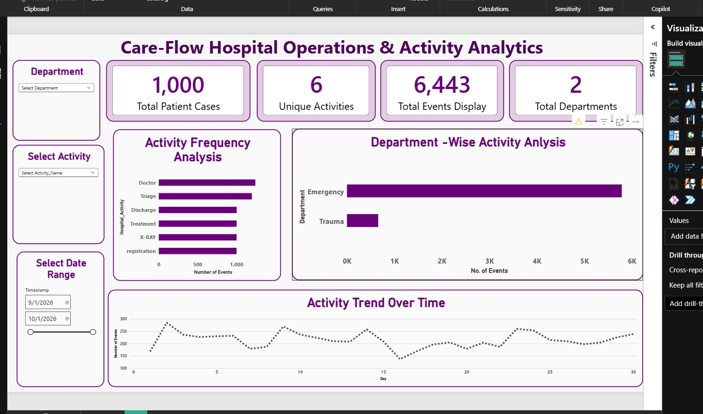

# CareFlow – Hospital Operations & Activity Analytics

## Project Overview
CareFlow is a hospital workflow analytics project that explores synthetic hospital event-log data to understand activity patterns, patient-case pathways, process transitions, and department-wise event distribution.

## Project Objectives
- Analyze hospital workflow events and patient cases.
- Explore activity frequencies and event sequences.
- Examine process transitions using SQL and PM4Py.
- Build an interactive Power BI dashboard for exploring workflow data.

## Tools & Technologies
- Python (Pandas, data cleaning, EDA)
- SQL and Google BigQuery
- PM4Py for process mining
- Power BI for interactive visualization
- GitHub for project version control

## Dataset
The practice dataset contains 6,443 workflow events across 1,000 patient cases. It is synthetic data for learning and portfolio demonstration, not real hospital data.

## Key Analysis
- Activity frequency analysis
- Patient-case event sequences and process variants
- Process transitions between activities
- Department-wise event distribution
- Activity trends over time

## Power BI Dashboard
The interactive dashboard includes:
- KPI cards for patient cases, events, unique activities, and departments
- Activity frequency chart
- Department-wise activity chart
- Activity trend chart
- Department, activity, and date-range slicers

### Dashboard Preview:

## Project Files
- Python notebook: data cleaning, EDA, and process analysis
- SQL folder: BigQuery analysis queries
- Power BI file: interactive dashboard

 ## Key Findings

- The dataset contains 6,443 workflow events across 1,000 patient cases.
- Doctor and Triage are among the most frequently recorded activities.
- Emergency has a higher recorded event volume than Trauma in this synthetic dataset.
- Interactive Power BI slicers allow users to explore activity patterns by department, activity type, and date range.

## Business Recommendations

- Monitor activity volumes across departments to understand workflow distribution.
- Review patient-case activity sequences to identify patterns that may need further investigation.
- Use date-range filters to compare activity trends across different periods.
- Validate findings against real operational data before making hospital management decisions.

# CareFlow SQL Analysis

## Objective
Use SQL in Google BigQuery to explore synthetic hospital workflow event data and identify activity patterns.

## Analysis Performed
- Checked dataset records and data quality.
- Analyzed event counts by hospital activity.
- Examined patient-case activity sequences.
- Explored transitions between consecutive activities.
- Compared event volumes across departments.
- Investigated repeated activities and workflow patterns.

## Tools Used
- Google BigQuery
- SQL

## Dataset
The dataset contains 6,443 workflow events across 1,000 patient cases. It is synthetic practice data and does not represent real hospital operations.

## Purpose
The SQL analysis supports exploratory data analysis and provides insights for the CareFlow Power BI dashboard.

This project uses synthetic practice data. Observed event counts and elapsed times should not be interpreted as validated real-world hospital performance or patient waiting times.
